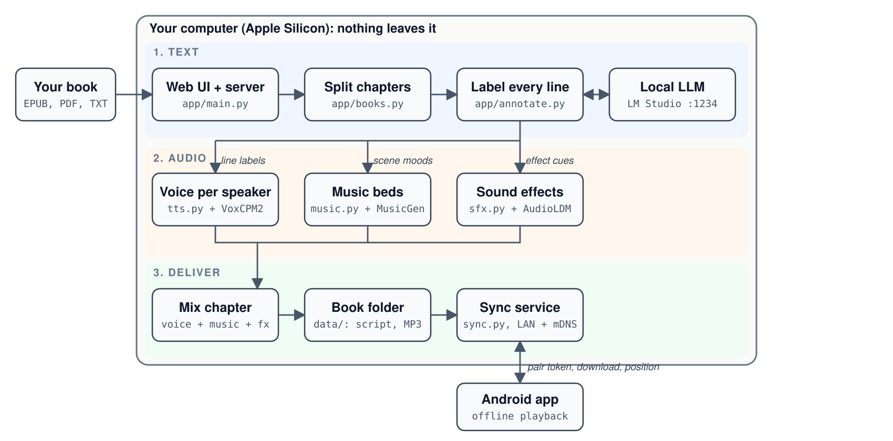

# Audiocast

Turn an ebook into a full-cast audiobook, entirely on your own machine.

Upload an EPUB, PDF or TXT. A local LLM labels every line (who speaks, how they feel, where to pause, what mood the scene has). Each character gets their own voice, the narrator gets a narrator voice, and optional background music and sound effects are mixed in. A companion Android app syncs the finished chapters over your LAN and plays them.

Nothing leaves your computer except an optional Wikipedia lookup of title and author (never book text).

## Demo


https://github.com/user-attachments/assets/78ce2cba-734b-4d74-a5fb-087c3e2a4af5


<!-- Drag the demo video here when editing this file on GitHub -->

The promo film is built with [HyperFrames](https://hyperframes.heygen.com) from `video/` (`cd video && npm run render`).


## How it works



### Pipeline

1. **Parse** (`app/books.py`): EPUB spine, PDF or TXT becomes chapters. PDF text is reflowed (page numbers removed, hyphens joined, paragraphs rebuilt).
2. **Annotate** (`app/annotate.py`): code splits each chapter into numbered narration and quote segments, so the book text can never be altered or dropped. The LLM only labels each segment id with speaker, emotion, pause and mood. Six LLM stages run per chapter, then emphasis and sound-effect passes. Chapters are framed with "Chapter N." and "End of chapter N."
3. **Cast** (`app/tts.py`): new characters get a designed voice; voices are reused across chapters of the same book. You can merge characters, redesign a voice or edit the script by hand.
4. **Render**: each line is spoken with VoxCPM2 (in its own virtualenv, as a long-lived worker process) and cached per line, so a crashed render resumes.
5. **Mix**: same-mood lines become music cues (MusicGen clips, loudness-matched, ducked under speech); sound effects (AudioLDM) are laid over the voice track.
6. **Sync**: the sync service announces itself over mDNS; the Android app pairs with a token, downloads chapters and uploads your listening position.

## Layout

| Path | What |
|---|---|
| `app/` | FastAPI server and pipeline (`main`, `books`, `annotate`, `tts`, `music`, `sfx`, `sync`, `lookup`, `vox_worker`) |
| `app/static/index.html` | Web UI (library, chapter table, script editor, cast, job queue) |
| `android/` | Kotlin / Compose player app with sync |
| `scripts/` | One-off helpers: model download, sample renders, chapter builder |
| `tests/` | pytest suite (parsing, annotation splitter, TTS cache, music, sfx, API, sync) |
| `BUILD_LOG.md` | Dated log of every build step, failures included |

## Requirements

- macOS on Apple Silicon (models run on MPS / MLX); 64 GB RAM recommended
- Python 3.12, [uv](https://github.com/astral-sh/uv), ffmpeg, espeak-ng
- [LM Studio](https://lmstudio.ai) serving a capable instruct model on `:1234` (developed with Qwen 27B)
- Android Studio / Gradle for the phone app

## Setup

```sh
uv venv --python 3.12 .venv
uv pip install --python .venv fastapi uvicorn python-multipart ebooklib beautifulsoup4 lxml pypdf \
    openai pydub soundfile numpy scipy pytest httpx zeroconf mlx-audio torch
brew install ffmpeg espeak-ng

# VoxCPM2 lives in its own environment so its torch/transformers cannot clash
uv venv --python 3.12 .venv-voxcpm
uv pip install --python .venv-voxcpm voxcpm
```

Model weights download from Hugging Face on first use (VoxCPM2 takes about 2 minutes to load).

## Run

```sh
.venv/bin/uvicorn app.main:app --port 8000
```

Open http://localhost:8000, upload a book, analyze chapters, tick the ones you want and queue script or audio renders. Pairing details for the phone are at `GET /api/sync/pairing`.

## Test

```sh
.venv/bin/pytest tests
```

The live LLM test needs LM Studio running and is skipped otherwise.

## Evaluation

Measured on an Apple M4 Max (64 GB) with Qwen 27B in LM Studio. Full method, worst-line analysis and caveats are in [`EVAL.md`](EVAL.md); gold speaker labels are in [`speakers_gold.csv`](speakers_gold.csv).

| What | Result |
|---|---|
| **Word fidelity** (each rendered line transcribed by Whisper `small.en` and compared to the script text) | **97.6%** mean match rate over 6 chapters (*Pride and Prejudice* Ch. I-III, *A Scandal in Bohemia* I-III); 596 lines, 71 min of audio. Strict scoring: 97.3% |
| **Speaker attribution** (hand-labeled gold, P&P Ch. I) | **97.0%** (32/33 speech lines). 21 unattributed back-and-forth lines were all correct. The one error is an illustration caption that leaked in from Ch. II |
| **Long lines** (900-3,600 characters through TTS) | No failures; 96.9-99.4% match |
| **Speed** (one 1,081-word chapter, 413 s of audio) | Real-time factor 0.61 for TTS alone, **1.15 for the full pipeline** (about 8 min wall) |
| **Peak memory** | About 54 GB system memory during TTS |

Every TTS error in the 10 worst lines came from one cause: Gutenberg markup (`[Illustration: ...]`, copyright lines) in the TXT being read aloud as prose. Cleaning that markup would lift P&P Ch. I from 95.5% to 97.5%.

Stress tests found real problems, none fixed yet:

- **TXT chapter detection** recognises 6 of 14 heading styles. `Chapter One`, bare `I.`, `Part One`, `BOOK I` and `* * *` all collapse to one chapter.
- **EPUB parsing** speaks footnote numbers and footnote bodies, and turns contents and notes pages into chapters.
- **Hard-wrapped TXT** (no blank lines) becomes one LLM chunk; around 300k characters it fails with HTTP 400.
- **Six-plus speakers** works, but one character can be cast under two names (`Lydia` / `Lydia Bennet`) and get two voices.

Caveats: single runs, one gold-labeled chapter (33 lines), and nothing was judged by ear.

## Known limits

- Audio quality and music fit are judged by ear; there is no automatic check beyond a Whisper round-trip on sample chapters.
- Gutenberg `[Illustration]` and copyright markup, EPUB footnotes, and unusual chapter-heading styles are not cleaned (see Evaluation).
- A 20 s music clip per mood is looped, so long scenes can audibly repeat.
- Annotation is slow on large local models (roughly minutes per chapter).
- `book/`, `data/` and `samples/` are git-ignored: bring your own books, and mind their copyright.

## License

See `LICENSE`.
